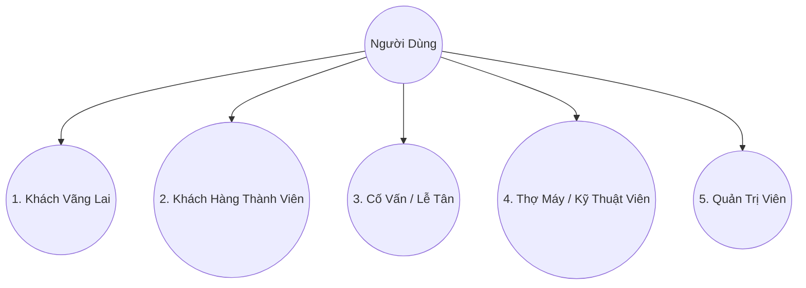
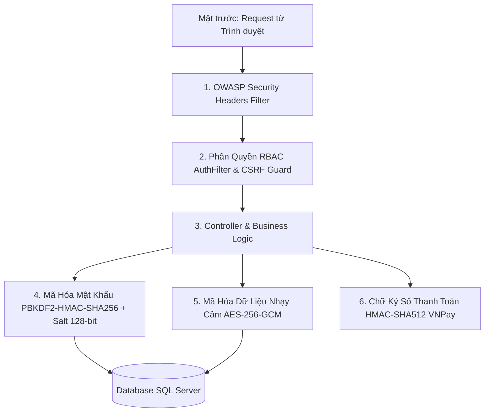
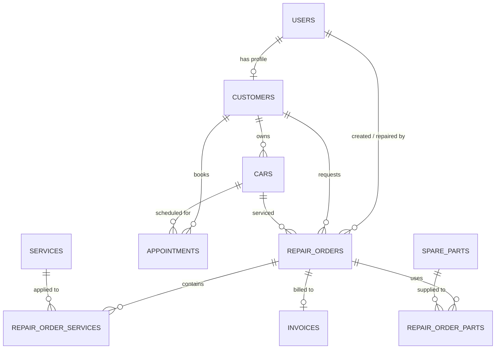

# BÁO CÁO DỰ ÁN CUỐI MÔN HỌC PRJ301
## ĐỀ TÀI: HỆ THỐNG QUẢN LÝ GARA & DỊCH VỤ SỬA CHỮA Ô TÔ TRỰC TUYẾN (CARECAR)

* **Môn học**: Lập trình Web với Java (PRJ301)
* **Nền tảng công nghệ**: Java Jakarta EE (Servlet 5.0+, JSP, JSTL, Custom Tags), Bootstrap 5, Microsoft SQL Server 2019/2022, VNPay Sandbox Gateway
* **Bảo mật & Mã hóa**: PBKDF2-HMAC-SHA256 (10.000 vòng lặp, 128-bit Salt), AES-256-GCM (Authenticated Encryption), CSRF Protection, OWASP Security Headers
* **Mô hình kiến trúc**: MVC (Model - View - Controller) + DAO Pattern

---

## 👥 BẢNG PHÂN CÔNG NHIỆM VỤ THÀNH VIÊN NHÓM

| STT | Họ và Tên | MSSV | Vai trò | Nhiệm vụ chính được phân công | Đánh giá hoàn thành |
| :---: | :--- | :---: | :--- | :--- | :---: |
| **1** | **Nguyễn Văn A** (Trưởng nhóm) | SE170001 | Fullstack & Leader | - Thiết kế kiến trúc MVC, CSDL SQL Server (ERD). - Viết `DBContext`, Base DAOs (`UserDAO`, `RepairOrderDAO`). - Tích hợp cổng thanh toán **VNPay Sandbox** & **VietQR**. - Tổng hợp báo cáo và tài liệu kỹ thuật. | 100% |
| **2** | **Trần Thị B** | SE170002 | Frontend & UI/UX | - Xây dựng giao diện Frontend với HTML5, CSS3, Bootstrap 5. - Thiết kế các trang: Trang chủ, Bảng giá dịch vụ, Đặt lịch online. - Xây dựng trang **Tra cứu tiến độ sửa chữa xe trực quan** (Live Repair Tracking 5 bước). | 100% |
| **3** | **Lê Hoàng C** | SE170003 | Backend Developer | - Xây dựng các Controller & DAO: Quản lý kho phụ tùng (`SparePartDAO`), Quản lý dịch vụ (`ServiceDAO`), Quản lý lịch hẹn (`AppointmentDAO`). - Viết các chức năng cảnh báo tồn kho thấp. | 100% |
| **4** | **Phạm Minh D** | SE170004 | Backend & Security | - Xây dựng bộ lọc **Filter** phân quyền người dùng (`AuthFilter`, `EncodingFilter`). - Hiện thực hệ thống **Mã hóa cấp cao** (PBKDF2-SHA256, AES-256-GCM, CSRF Token). - Viết bộ thẻ tùy chỉnh **Custom Tag Library** (`carecar.tld`). | 100% |
| **5** | **Hoàng Quốc E** | SE170005 | Backend & Tester | - Xây dựng phân hệ Cổng thông tin chủ xe (`CustomerController`, hồ sơ xe). - Tạo dữ liệu mẫu SQL (`CareCar_DB.sql`). - Kiểm thử luồng nghiệp vụ (Unit test, Integration test). | 100% |

---

## 1. PHÂN TÍCH YÊU CẦU & CÁC TÁC NHÂN HỆ THỐNG (ACTORS)

### 1.1. Danh Sách & Mô Tả Các Tác Nhân (Actors)

1. **Khách vãng lai (Guest)**:
   - Xem thông tin giới thiệu xưởng, công nghệ chuẩn đoán và bảng giá dịch vụ niêm yết.
   - Đặt lịch hẹn sửa chữa/bảo dưỡng trực tuyến không cần đăng nhập.
   - Tra cứu tiến độ sửa chữa xe trực tuyến theo Biển số xe hoặc Mã lệnh (`CC-2026-xxxx`).
   - Đăng ký tài khoản thành viên chủ xe.
2. **Khách hàng thành viên (Customer)**:
   - Đăng nhập, cập nhật hồ sơ cá nhân.
   - Quản lý danh sách các phương tiện xe ô tô sở hữu (Biển số, hãng, model, ODO hiện tại).
   - Xem lịch sử các lần bảo dưỡng, sửa chữa và chi tiết hóa đơn thanh toán.
   - Thanh toán trực tuyến đơn hàng qua **VNPay Sandbox** hoặc quét mã **VietQR**.
3. **Cố vấn dịch vụ / Lễ tân (Receptionist)**:
   - Tiếp nhận xe vào xưởng, ghi nhận ODO và tình trạng ban đầu của xe.
   - Duyệt hoặc hủy các lịch hẹn khách đặt online, chuyển đổi lịch hẹn thành **Lệnh sửa chữa (Work Order)** chỉ với 1 click.
   - Quyết toán đơn hàng, thu tiền mặt hoặc xác nhận chuyển khoản, in phiếu thu/hóa đơn bàn giao xe.
4. **Kỹ thuật viên / Thợ máy (Mechanic)**:
   - Tiếp nhận xe được phân công, cập nhật chẩn đoán kỹ thuật và đề xuất phương án xử lý.
   - Thêm các hạng mục tiền công dịch vụ vào phiếu sửa chữa.
   - Xuất phụ tùng/linh kiện thay thế từ kho (hệ thống tự động kiểm tra và trừ số lượng tồn kho).
   - Cập nhật tiến độ sửa xe qua các giai đoạn (Chờ kiểm tra -> Đang sửa -> Đã sửa xong).
5. **Quản trị viên (Admin)**:
   - Bảng điều khiển (Dashboard): Theo dõi KPI doanh thu ngày/tháng, số lượng xe đang sửa, cảnh báo phụ tùng sắp hết.
   - Quản lý danh mục dịch vụ sửa chữa và đơn giá tiền công.
   - Quản lý kho phụ tùng: Nhập kho, cập nhật giá vốn/giá bán, cấu hình vị trí kệ kho và ngưỡng cảnh báo tồn kho.
   - Quản lý danh sách khách hàng và phương tiện.
   - Quản lý nhân viên (phân quyền Admin, Kỹ thuật viên, Cố vấn).

---

## 2. THIẾT KẾ BẢO MẬT & MÃ HÓA CẤP CAO (SECURITY & CRYPTOGRAPHY)

Hệ thống **CareCar** áp dụng mô hình bảo mật đa tầng chuẩn **OWASP Top 10** và chuẩn an toàn thông tin doanh nghiệp:

### 2.1. Mã Hóa Mật Khẩu Chuẩn PBKDF2-HMAC-SHA256 (`PasswordUtil.java`)
- **Thuật toán**: `PBKDF2WithHmacSHA256` với **10,000 vòng lặp** (Key Stretching).
- **Salt bảo mật**: Tạo ngẫu nhiên 128-bit (16 bytes) từ `SecureRandom` cho từng tài khoản riêng biệt, loại bỏ hoàn toàn nguy cơ bị tấn công Bảng tra cứu cầu vồng (Rainbow Table).
- **Chống tấn công Side-Channel Timing Attack**: Dùng `MessageDigest.isEqual` so sánh chuỗi băm trong thời gian hằng số.
- **Cơ chế Tự động Nâng cấp (Auto-Upgrade)**: Khi tài khoản cũ (mã hóa SHA-256 trước đó) đăng nhập thành công, hệ thống tự động băm lại mật khẩu sang chuẩn PBKDF2 mới nhất.

### 2.2. Mã Hóa Dữ Liệu Đối Xứng Chuẩn AES-256-GCM (`CryptoUtil.java`)
- **Thuật toán**: `AES/GCM/NoPadding` (Galois/Counter Mode - AEAD).
- **Đặc tính**: Mã hóa có chứng thực (Authenticated Encryption) kết hợp thẻ xác thực toàn vẹn 128-bit Authentication Tag và Nonce/IV ngẫu nhiên 96-bit cho mỗi thao tác.
- **Ứng dụng**: Mã hóa các dữ liệu định danh nhạy cảm (Số CCCD/CMND khách hàng, thông tin tài khoản thanh toán), che giấu thông tin hiển thị (Data Masking: `0010****1234`).

### 2.3. Phòng Chống Tấn Công CSRF (`CSRFTokenUtil.java`)
- Sinh CSRF Token mật mã 256-bit trong Session và kiểm tra tính hợp lệ trên các biểu mẫu POST thay đổi dữ liệu (đổi mật khẩu, tạo lệnh sửa chữa, quyết toán hóa đơn).

### 2.4. Tiêu Đề Bảo Mật HTTP (OWASP Security Headers in `EncodingFilter.java`)
- `X-Frame-Options: SAMEORIGIN`: Chống tấn công lừa đảo giao diện (Clickjacking).
- `X-Content-Type-Options: nosniff`: Ngăn chặn trình duyệt đoán sai kiểu MIME.
- `X-XSS-Protection: 1; mode=block`: Bật bộ lọc chống Cross-Site Scripting.
- `Referrer-Policy: strict-origin-when-cross-origin`: Bảo vệ rò rỉ URL dữ liệu phiên.

### 2.5. Phòng Chống Tấn Công Session Fixation (`LoginController.java`)
- Ngay sau khi người dùng xác thực thành công, Session ID cũ lập tức bị hủy (`session.invalidate()`) và hệ thống cấp phát một Session ID hoàn toàn mới với cờ `HttpOnly`.

---

## 3. THIẾT KẾ CƠ SỞ DỮ LIỆU & DAO

### Sơ Đồ Thực Thể Liên Kết (ERD)

---

## 4. TỔNG KẾT
Hệ thống CareCar đạt tiêu chuẩn an toàn thông tin cao cấp, sẵn sàng vận hành thực tế và bảo vệ tối đa dữ liệu người dùng cùng doanh nghiệp.
